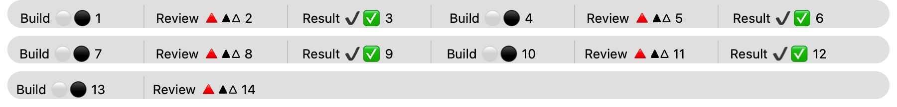

# iTerm2 — accessibility fork

This is an independent fork of [the official iTerm2 project](https://github.com/gnachman/iTerm2), a terminal emulator for macOS.

The goal is to add practical accessibility and usability improvements, particularly for **portrait displays** and **monochrome monitors**. This fork is experimental and is not an official iTerm2 release.

## Available now: multi-row bottom tabs

The first custom native feature is a bottom tab bar that wraps onto multiple rows. It makes large collections of tabs easier to read when horizontal space is limited.

- Rows occupy their own space below the terminal instead of covering its contents.
- Choose automatic sizing based on minimum tab width, or a fixed number of tabs per row, such as six.
- The bar is limited to 40% of the window height; additional tabs remain accessible through the overflow menu.
- The feature is disabled by default.



Native renderer fixture with sample titles; no personal terminal contents.

### Enable it

1. Open **Settings → Appearance → General** and set **Tab bar location** to **Bottom**.
2. Open **Settings → Advanced**. In the search field inside the Advanced panel, search for **Wrap bottom tabs** and enable **Wrap bottom tabs onto multiple rows**.
3. Search for **Number of tabs per row**:
   - **0** selects automatic sizing (the default).
   - **1–100** sets a fixed count; **6** gives six tabs per row.
4. In automatic mode, adjust **Minimum width of tabs in a wrapping bottom tab bar** if desired (default: 160 points). Fixed columns override this minimum.

The implementation and current testing notes are available in [the draft pull request within this fork](https://github.com/dejafait/iTerm2/pull/1). It is not an upstream submission. Broader manual testing, including dragging, tab groups and fullscreen, is still needed.

## Configurable palette-style tabs


Native renderer fixture with sample titles and an active-window state; no private terminal content.

The second feature is an opt-in, high-contrast button style for wrapping horizontal tabs on macOS 26 or later (Tahoe renderer). Enable **Settings → Advanced → Palette tab bar style** after enabling wrapping bottom tabs. No default theme is changed.

Appearance can be edited without rebuilding or restarting. Create `tab-style.json` in the application’s Application Support directory: normally `~/Library/Application Support/iTerm2/`, or the explicit suite directory when launched with `-suite` (for example `iterm22-preview`). The file is checked twice per second; valid changes trigger the preferences/layout refresh. Invalid JSON or an unsupported version retains the last valid snapshot.

```json
{
  "version": 1,
  "height": 36,
  "rowGap": 6,
  "columnGap": 6,
  "cornerRadius": 7,
  "horizontalPadding": 8,
  "marginLeft": 6,
  "marginRight": 6,
  "barBackground": "#ffffff",
  "truncation": "middle",
  "indicators": {
    "activity": {
      "enabled": false,
      "position": "right"
    },
    "counter": {
      "enabled": false,
      "position": "right"
    },
    "progress": {
      "enabled": true,
      "position": "outline"
    },
    "status": {
      "enabled": false,
      "position": "right"
    },
    "graphic": {
      "enabled": false,
      "position": "right"
    },
    "pin": {
      "enabled": false,
      "position": "right"
    },
    "close": {
      "enabled": true,
      "position": "left"
    }
  },
  "states": {
    "activeUnselected": {
      "background": "#ffffff",
      "foreground": "#000000",
      "border": "#000000",
      "borderWidth": 2,
      "fontFamily": "",
      "fontSize": 17,
      "fontWeight": "medium",
      "italic": false
    },
    "activeSelected": {
      "background": "#eeeeee",
      "foreground": "#000000",
      "border": "#000000",
      "borderWidth": 2,
      "fontFamily": "",
      "fontSize": 17,
      "fontWeight": "medium",
      "italic": false
    },
    "inactiveUnselected": {
      "background": "#ffffff",
      "foreground": "#000000",
      "border": "#000000",
      "borderWidth": 2,
      "fontFamily": "",
      "fontSize": 17,
      "fontWeight": "medium",
      "italic": false
    },
    "inactiveSelected": {
      "background": "#eeeeee",
      "foreground": "#000000",
      "border": "#000000",
      "borderWidth": 2,
      "fontFamily": "",
      "fontSize": 17,
      "fontWeight": "medium",
      "italic": false
    }
  },
  "paddingTop": 0,
  "paddingBottom": 0,
  "columnGapColor": "#ffffff",
  "marginTopColor": "#ffffff",
  "marginBottomColor": "#ffffff",
  "marginLeftColor": "#ffffff",
  "marginRightColor": "#ffffff"
}
```

- `height` is the button height in points (16–240), independent of `rowGap`. Together with `paddingTop` and `paddingBottom` they form row pitch. `columnGap`, `marginLeft`, `marginRight`, `horizontalPadding` and `cornerRadius` control spacing and shape.
- `barBackground` colors the space around buttons; `columnGapColor` and `marginTopColor`, `marginBottomColor`, `marginLeftColor`, `marginRightColor` can override each surrounding region. Colors accept #RRGGBB or #RRGGBBAA.
- The four independent states are selected/unselected × active/inactive window. Each accepts background, foreground, border, borderWidth, fontFamily (PostScript name; empty means system), fontSize, fontWeight (light/regular/medium/semibold/bold/heavy), and italic. The example keeps inactive-window contrast identical and uses a light gray selected background.
- `truncation`: `head` removes the beginning and preserves the suffix; `tail` preserves the beginning; `middle` keeps both ends; `clip` clips without an ellipsis. This applies consistently to the entire title and its existing emoji, without changing the actual tab name.
- Native activity, counter, status, graphic, pin and close decorations support enabled and left/right placement. Progress supports enabled and left/right/outline placement. The title’s own emoji remain part of the title; no emoji are synthesized by this renderer.
- Native profile settings still control terminal text fonts/colors. This file controls tab labels. Small heights intentionally clip oversized text; choose height appropriate to the selected font.

## What comes next

More accessibility improvements are planned, with particular attention to portrait layouts and readable, high-contrast interfaces on monochrome displays.

**A dedicated monochrome mode is not implemented yet.** Future ideas are not included in the current feature list.

## Trying this fork

This fork currently targets development builds. No packaged public release or Homebrew tap is provided yet.

For the original project's build instructions and general documentation, see:

- [Official iTerm2 README](https://github.com/gnachman/iTerm2/blob/master/README.md)
- [Official documentation](https://iterm2.com/documentation.html)
- [Official downloads](https://iterm2.com/downloads.html) — these contain the official application, without this fork's additions.

## Project structure

`main` preserves the official baseline. Each feature PR targets the preceding feature branch and stays open for public review. `release` contains all features at the top of the stack and is the default branch. There is no personal integration branch.

## Credits and license

All credit for the original iTerm2 application belongs to its authors and contributors. This fork builds on their work and preserves the project's existing license files and notices. See [LICENSE](LICENSE), [COPYING](COPYING), and [README.license](README.license).
